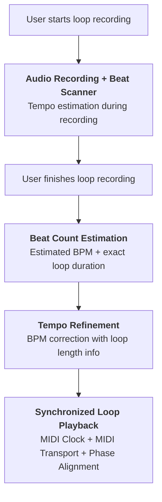
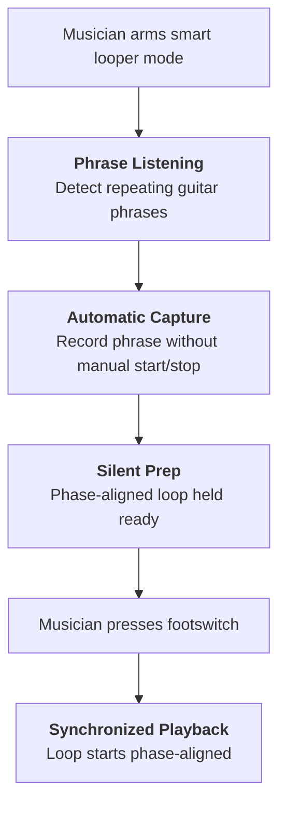
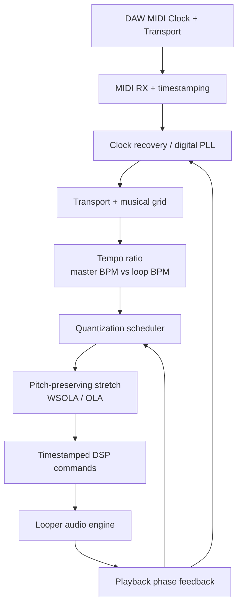

# Looper MIDI Sync Proposals

## Kemper as MIDI Master

### Phase 1 — Beat Scanner for the Looper

**Effort:** Low · **Impact:** Medium

At the moment we cannot read an estimated BPM from a recorded loop sample. Enabling the beat scanner for the looper would close that gap.

With MIDI transport sync (play, stop, pause) and phase quantization added on top, the full **Kemper as MIDI Master** feature becomes viable.

#### Suggested flow

### Phase 2 — Smart Looper Mode

**Effort:** High(Experimental) · **Impact:** High (potential product differentiator)

Introduce a smart looper mode that listens for repeating guitar phrases, records them automatically, and holds a silent, phase-aligned loop ready to go. One footswitch press starts playback whenever the musician wants. Loop recording start and stop no longer need to be timed manually. 

#### Suggested flow

## Kemper as MIDI Slave

**Effort:** High · **Impact:** High

Synchronize the looper to an external MIDI Clock master (e.g. Ableton Live). Recording and playback boundaries follow the external musical grid, and long-term phase drift is corrected via a digital PLL.

When the master tempo changes, the recorded loop is time-stretched with **pitch held fixed** (WSOLA for live tracking). After stretch, loop length is re-locked to an integer beat count so phase stays aligned with the MIDI grid.

#### Suggested flow

